 <h2>Hi 👋, I'm Seung Hyun Kim</h2>

  [][linkedin] 

 
I'm an engineer and researcher interested in soft robotics, computational mechanics, and biological computing. My PhD research spans physics-based simulation, robot control, and computing with living neural networks.

 
My interests extend beyond those areas to growing wetware, including Oscillomorph and MorphoHDL, as well as artificial life, emergence, embodied AI, and non-equilibrium physics.

 ---

 <h3>🔥 Tech Stack 🔥</h3>
 <h4>Languages</h4>
 

  
  
  
  
  
  
  
  
 

 <h4>Scientific Computing &amp; Robotics</h4>
 

  
  
  
  
  
  
  
 

 <h4>High-Performance Computing &amp; Tools</h4>
 

  
  
  
  
  
  
  
  
 

 <h4>CAD &amp; Simulation</h4>
 

  
  
  
  
  
  
 

 <h4>Visualization</h4>
 

  
  
  
  
  
  
 

 <h4>AI &amp; Automation</h4>
 

  
  
  
 

 ---

 <h3>Explore the Code</h3>

- 🌀 [**PyElastica**](https://github.com/GazzolaLab/PyElastica) — A Python framework for simulating soft, flexible structures. I was part of its architecture, packaging, releases, and community development.
- 🦾 [**gym-softrobot**](https://github.com/skim0119/gym-softrobot) — Gymnasium environments I built for soft-robot simulation and control using PyElastica. Start here for my Python work on simulation interfaces and robotics workflows.
- 🧠 [**MiV-OS**](https://github.com/GazzolaLab/MiV-OS) — A collaborative Python framework for electrophysiology analysis. I developed reusable pipelines for neural recordings and high-throughput computing.
- ⚙️ [**Elastica++**](https://github.com/GazzolaLab/elasticapp) — A collaborative C++ framework for simulating flexible filaments. I contributed to performance and scalability work for large assemblies.

I care about making research software usable across projects and teams, connecting numerical models to experiments, and understanding performance as systems scale.

 ---

 
 

 

[linkedin]: https://www.linkedin.com/in/seung-hyun-kim-6118a3157/
